# Teste do script vp

## Parte 1 - Casos base

### Teste 1 — -p sem diretórios indicados termina com erro 
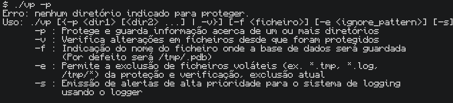

### Teste 2 — -v sem base de dados existente termina com erro 
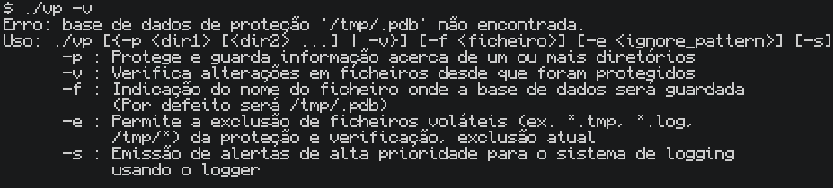

### Teste 3 — -p e -v usados em simultâneo termina com erro 
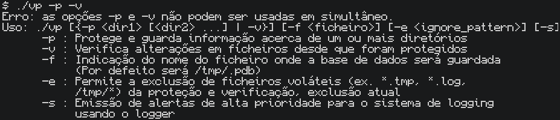

### Teste 4 — Proteger um diretório com sucesso (mensagem "criada com sucesso")
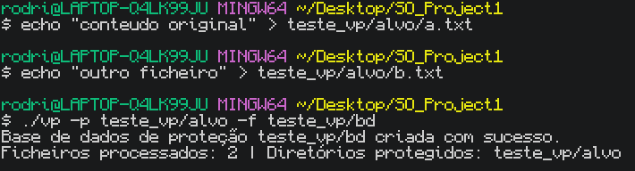

### Teste 5 — O ficheiro da base de dados é criado após o -p, e fica sem permissão de escrita (read-only)
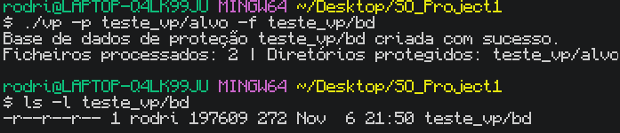

### Teste 7 — Verificação sem alterações reporta tudo como verificado (0 modificados/apagados/novos)

### Teste 8 — Alteração de conteúdo de um ficheiro é detetada ("Conteúdo")
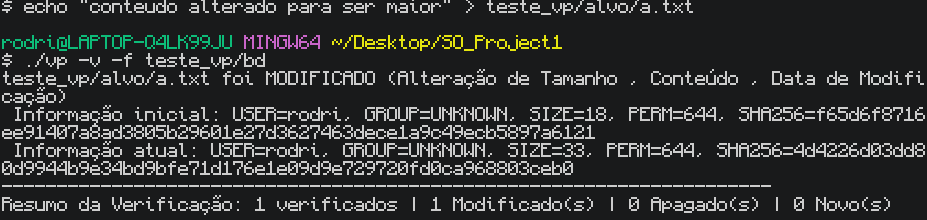

### Teste 9 — Ficheiro apagado é detetado ("foi APAGADO")
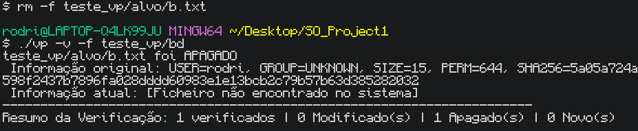

### Teste 10 — Ficheiro novo é detetado ("é NOVO")
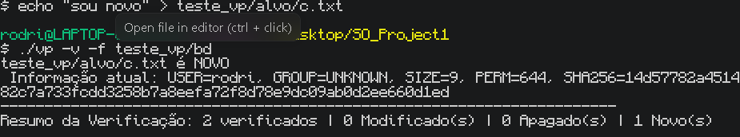

### Teste 11 — Exclusão de padrões (-e) ignora ficheiros na proteção e na verificação
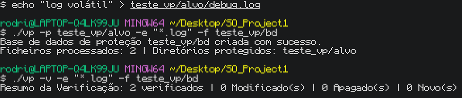

### Teste 12 — Resumo final mostra contagens corretas com múltiplas alterações (modificado + apagado + novo)
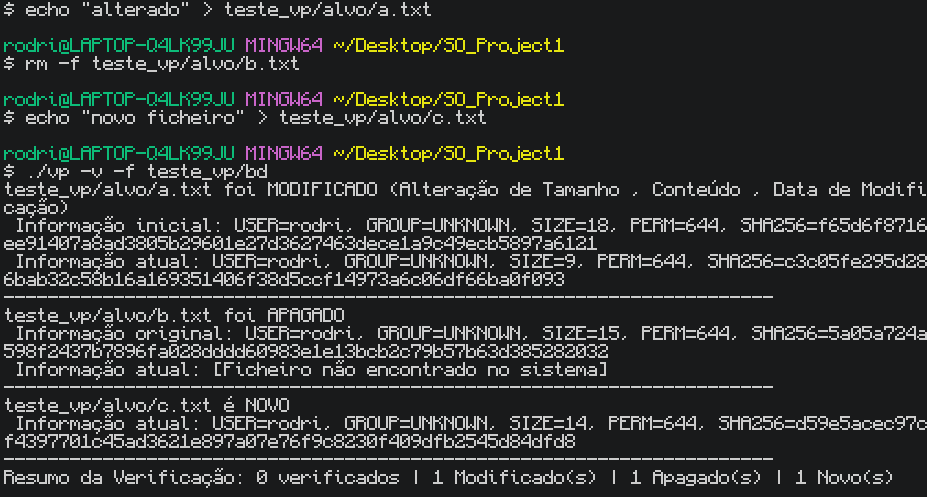

### Teste 13 — Proteger múltiplos diretórios ao mesmo tempo funciona e é refletido no resumo
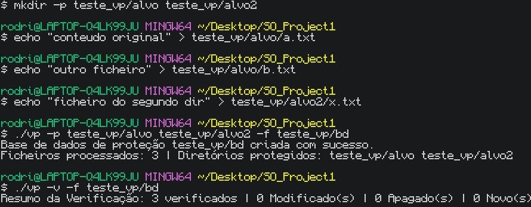

### Teste 14 — Proteção falha corretamente quando a BD não pode ser escrita (não reporta falso sucesso)
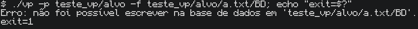

### Teste 15 — Proteção falha corretamente quando o diretório indicado não existe
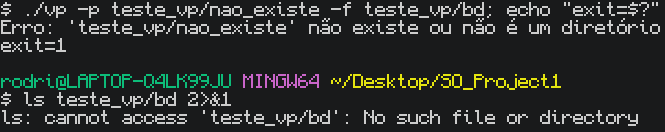

## Parte 2 - Edge cases

### Teste 16 — Alteração apenas de permissões (chmod) é detetada ("Permissões")
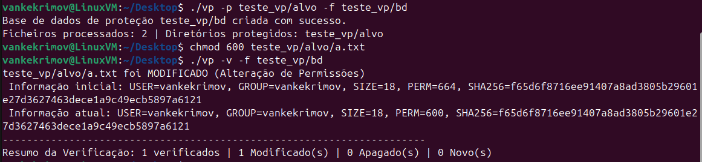

### Teste 17 — Alteração apenas da data de modificação (touch, sem mudar conteúdo) é detetada
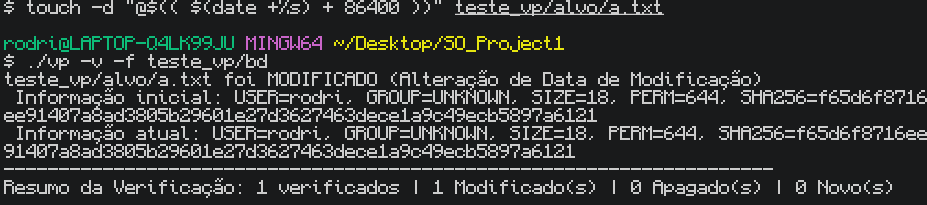

### Teste 18 — Conteúdo alterado mantendo o mesmo tamanho é detetado (deteção pelo hash, não pelo tamanho)
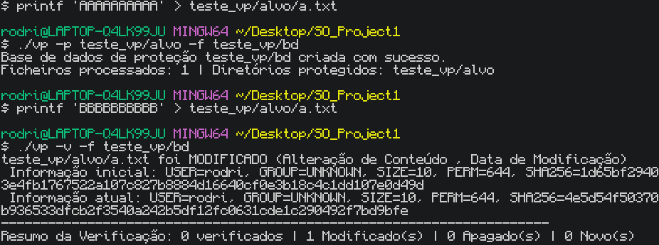

### Teste 19 — -v sem -e herda o padrão de exclusão guardado na BD (definido no -p)
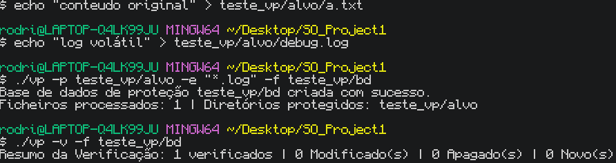

### Teste 20 — -v com -e diferente do usado no -p substitui a exclusão guardada
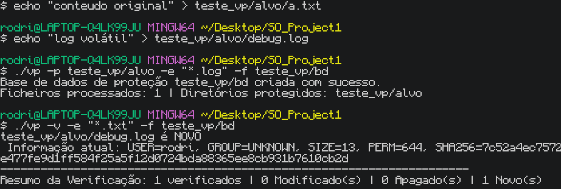

### Teste 21 — Exclusão de padrão (-e) aplica-se também a ficheiros em subdiretórios aninhados
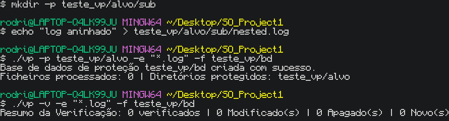

### Teste 22 — -f sem valor a seguir termina com erro (não consome a próxima flag por engano)
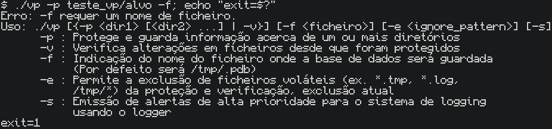

### Teste 23 — -e sem valor a seguir termina com erro
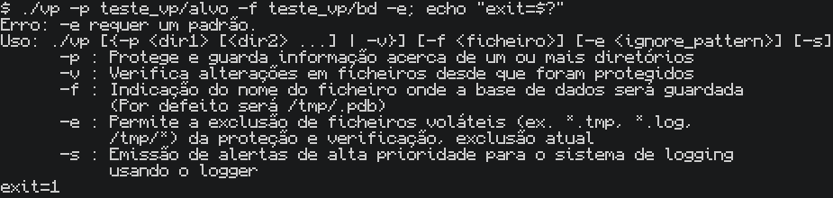

### Teste 24 — Switch desconhecido (ex. -x) termina com erro e mostra mensagem clara
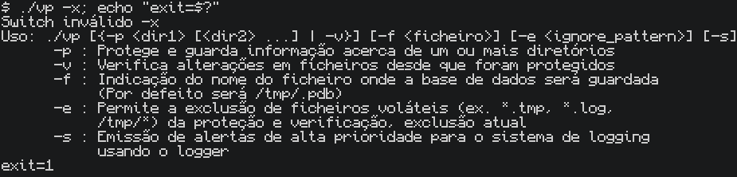

### Teste 25 — Flags podem aparecer depois dos argumentos posicionais (ex. "vp dir -p -f db")
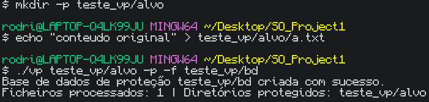

### Teste 26 — Sem -p e sem -v, com diretório posicional dado: comporta-se como -v e ignora o diretório
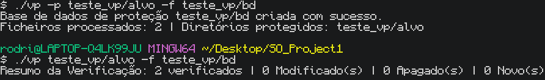

### Teste 27 — Exit code de sucesso é 0 tanto na proteção como na verificação
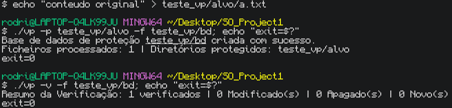

### Teste 28 — Nomes de ficheiros com espaços são tratados corretamente
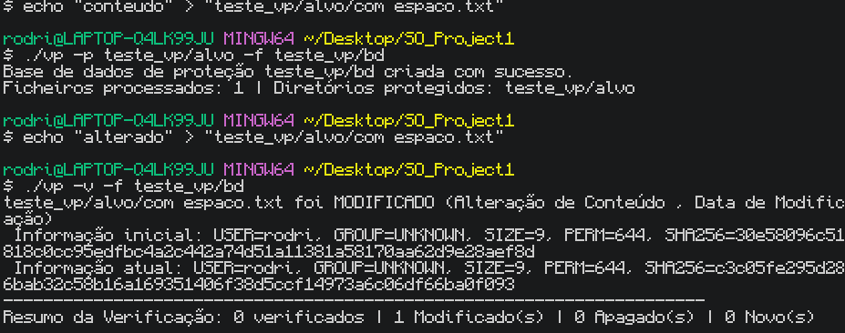

### Teste 29 — Proteger/verificar um diretório vazio (0 ficheiros) funciona sem erros
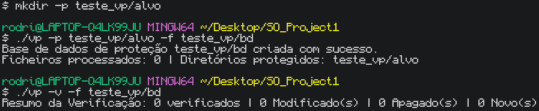

### Teste 30 — Subdiretórios aninhados (vários níveis) são percorridos recursivamente
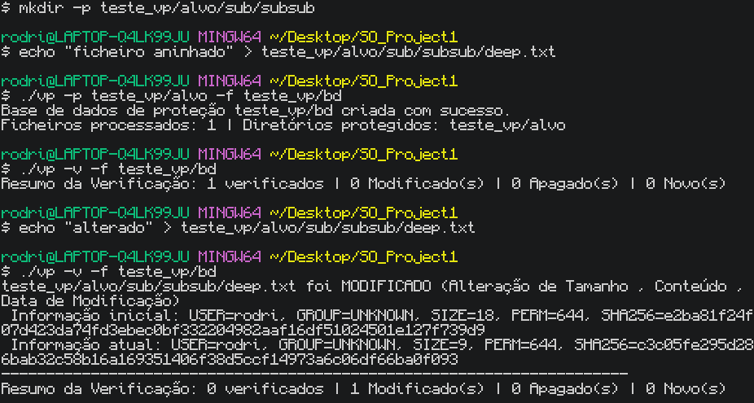

### Teste 31 — Reproteger substitui uma BD anterior só de leitura, sem ser preciso apagá-la à mão
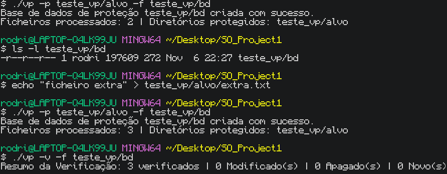

### Teste 32 — -f com diretório-pai inexistente no caminho termina com erro (não só quando é um ficheiro a bloquear)
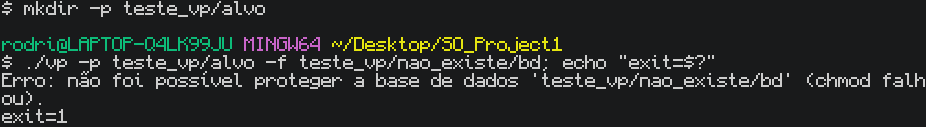

### Teste 33 — Proteger um diretório que contém a própria BD causa auto-modificação na verificação seguinte
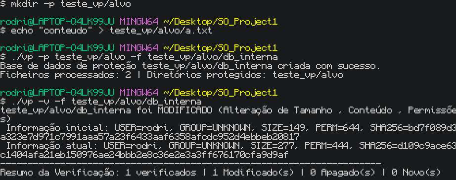

### Teste 34 — -s emite um alerta via logger quando é detetada uma alteração
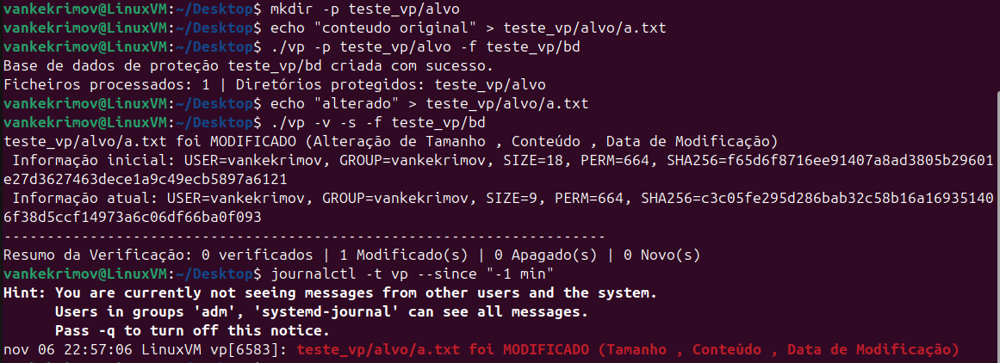

### Teste 35 — Ficheiro sem permissão de leitura é omitido silenciosamente da BD (sem aviso ao utilizador)
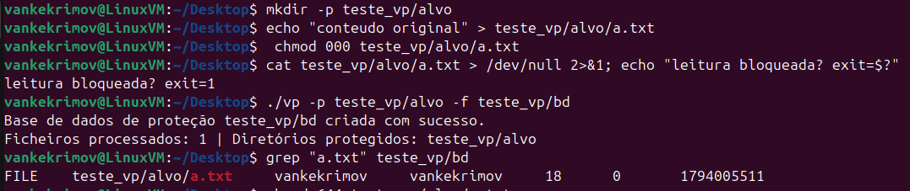
